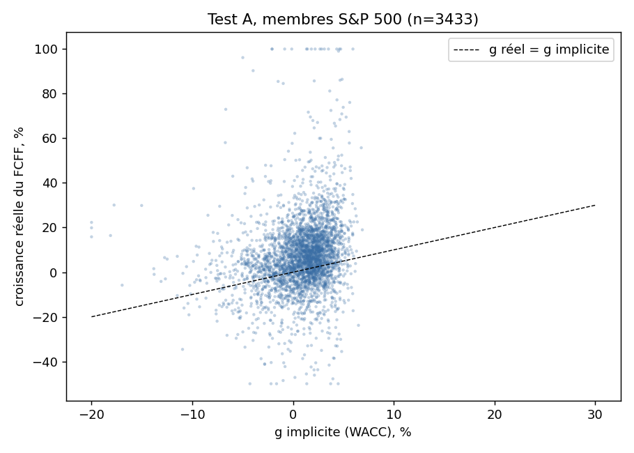
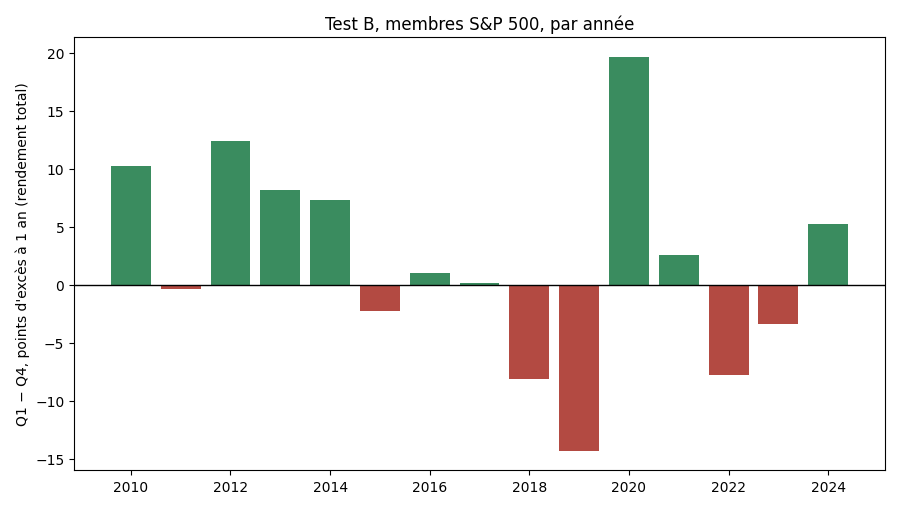

# Reverse DCF sur le S&P 500

**Question.** Un prix de marché contient une croissance attendue. Si on prend le flux de trésorerie libre (FCFF) d'une société et sa valeur d'entreprise (VE), quelle croissance perpétuelle g le marché paie-t-il ? Et cette croissance implicite dit-elle quelque chose de la croissance qui a suivi, ou du rendement de l'action ?

## Méthode

1. **Fondamentaux** : états financiers annuels des 10-K (SEC, `companyfacts`), 2010 à 2026, pour les sociétés du S&P 500 (anciennes et actuelles).
2. **Prix** : cours à la date de clôture de l'exercice, remis dans l'unité de l'époque (avant splits), pour calculer la capitalisation.
3. **Valeur d'entreprise** : VE = capitalisation + dette − trésorerie. La trésorerie comprend les placements à court terme et les titres non courants (jamais les participations).
4. **FCFF** = flux de trésorerie d'exploitation + intérêts × (1 − impôt) − capex (impôt 35 % jusqu'en 2017, 21 % ensuite ; intérêts non publiés estimés par dette × 5 % et marqués ; moyenne sur 5 ans pour les cycliques).
5. **g implicite** : VE = FCFF × (1 + g) / (r − g), donc g = (VE × r − FCFF) / (VE + FCFF) = (r − y) / (1 + y), avec y = FCFF / VE.
6. **Taux r** : WACC de marché = E/V × (taux du Trésor 10 ans + 5 %) + D/V × (taux 10 ans + 1,5 pt) × (1 − impôt), cycliques +1 pt. Taux FRED (DGS10) à la date de clôture, jamais postérieur. L'ancien r fixe de 9 % reste disponible (`py a12_g_implicite.py fixe`).
7. **Périmètre** : banques, assurances (y compris les assureurs santé, SIC 6324), foncières, sociétés régulées exclues (le FCF n'y a pas le même sens) ; blocs sectoriels par code SIC.
8. **Tests** (principe détaillé ci-dessous) : (A) g implicite contre la croissance réelle du FCFF, du FCFF de N−1 à la moyenne N+2..N+4 (4 ans ; pour les cycliques, de la moyenne N−5..N−1 à N+2..N+4, 6 ans) ; (B) rendement des actions par quartile de FCFF / VE, par année, rendements limités aux percentiles 1 % et 99 %, avec t de Newey-West et t sur départs non chevauchants.
9. **Univers** : les conclusions portent sur les sociétés **membres du S&P 500 à la date de clôture** (établi par CIK, pas par ticker). « Toutes » et « hors indice » servent de contrôle.

## Principe des deux tests

- **Test A : le prix annonce-t-il la croissance qui suit ?** Pour chaque société et chaque année, on compare le g implicite (la croissance que le prix suppose) au g réel : la croissance annuelle composée du FCFF, de N−1 (dernier exercice connu à la clôture) à la moyenne de N+2 à N+4. Un point du graphique A est une société pour une année ; on mesure la corrélation de rang (Spearman) sur toutes les lignes réunies, pas une moyenne par société. Exemple : Henry Schein, exercice 2015, g implicite 2,1 %, g réel 3,0 % (FCFF de 526 M$ en 2014 à 591 M$ en moyenne 2017-2019, soit 4 ans).
- **Test B : les sociétés peu chères ont-elles eu un meilleur rendement ?** Le test porte sur le rendement FCFF / VE (y). Comme g = (r − y) / (1 + y) baisse quand y monte, un FCFF / VE élevé correspond, à une date donnée, à un g implicite bas (société peu chère) et un FCFF / VE bas à un g haut (société chère). Chaque année, on classe les sociétés en quartiles de FCFF / VE : Q1 = le plus haut (peu cher, g bas), Q4 = le plus bas (cher, g haut). Trier sur y plutôt que sur g évite de mélanger des dates à taux r différents. On calcule ensuite le rendement total de chaque action à 1 et 3 ans (à partir du premier jour de bourse après le dépôt du 10-K), moins la médiane des rendements de toutes les sociétés cette année-là : c'est le rendement en excès. La barre du graphique B est l'excès moyen de Q1 moins celui de Q4, une barre par année : verte si les peu chères ont battu les chères, rouge sinon. Le test B n'utilise ni g implicite ni g réel, seulement des rendements.




*Lecture des graphiques : axes tronqués à l'affichage (graphique A : g implicite de −20 % à +30 %, croissance réelle de −50 % à +100 % ; les points alignés au bord sont des valeurs coupées). La corrélation de 0,26 est calculée sur toutes les lignes, sans troncature. Images produites par `a16_graphiques.py`.*

## Résultats (données corrigées, WACC de marché)

- **Test A.** Un g implicite plus haut va avec une croissance du FCFF ensuite plus haute : corrélation de rang 0,26 (3 433 lignes de membres, 4 741 au total). La base de croissance est le FCFF de N−1 : celui de N sert déjà à calculer g.
- **« Le marché est trop prudent »** : le FCFF a progressé plus vite que g dans 69 % des cas (membres), 72 % (toutes), 65 % avec r = 9 %. Ce chiffre dépend du taux choisi, pas seulement du marché ; il ne prouve pas que le marché se trompait.
- **Test B.** (Principe : voir « Principe des deux tests ».) Les g bas ont battu les g hauts 9 années sur 15 à 1 an (+2,0 points en moyenne, t 0,9) et 7 années sur 13 à 3 ans (+1,3 point par an, t 0,9 ; Newey-West 0,7) chez les membres de l'indice ; hors indice l'écart s'inverse (−4,9 et −2,9 points). Rien de significatif, et le résultat change de signe selon l'univers : on ne peut conclure ni à un signal de sélection ni à son absence. Le test B ne change pas avec le taux r (le tri sur FCFF / VE ne dépend pas de r).

## Choix principaux (et pourquoi ils comptent)

| Choix | Valeur retenue | Ce que ça change |
|---|---|---|
| Taux d'actualisation r | WACC de marché par année : taux du Trésor 10 ans à la date de clôture + prime de risque 5 % (actions), + 1,5 point d'écart de crédit (dette), impôt 35 % jusqu'en 2017 puis 21 %, cycliques + 1 point | Le niveau de g en dépend directement (un r plus haut donne un g plus haut). Un seul r par année pour toutes les sociétés : pas de bêta par société. Option `py a12_g_implicite.py fixe` : ancien r fixe (9 %, 10 % pour les cycliques), écrit `g_implicite_fixe.csv` |
| Flux de trésorerie | FCFF = flux d'exploitation + intérêts × (1 − impôt) − capex ; moyenne sur 5 ans pour les cycliques | Un capex ou des intérêts mal lus déplacent g ; les cas douteux sont signalés (`controles_a15.csv`) |
| Valeur d'entreprise | capitalisation + dette − trésorerie (placements court terme et titres non courants inclus, participations exclues) | Une VE incomplète gonfle ou réduit g |
| Périmètre | banques, assurances, foncières et sociétés régulées exclues ; membres du S&P 500 à la date de clôture (par CIK) pour les conclusions | Le FCF n'a pas le même sens pour ces secteurs ; « hors indice » et « toutes » ne servent que de contrôle |
| Base de croissance du test A | FCFF de N−1 (cycliques : moyenne N−5 à N−1), comparé à la moyenne N+2 à N+4 | Avec le FCFF de N en base, la corrélation devient en grande partie mécanique (de l'ordre de 0,44 au lieu de 0,26), parce que g est calculé sur ce même FCFF |
| Rendements du test B | rendement total (dividendes et splits compris), départ le premier jour de bourse après le dépôt du 10-K, horizons 1 et 3 ans, rendements limités aux percentiles 1 % et 99 % de chaque année | Un départ avant la publication des comptes donnerait un avantage que l'investisseur n'avait pas |
| Lignes écartées | FCF / VE < 1 % (839 lignes), exclusions manuelles (72 lignes) | La plage de g est tronquée (g ≤ 8,9 %) ; voir Limites |

Ces choix sont des hypothèses, pas des vérités : aucun n'a été optimisé pour obtenir un résultat.

## Limites

- Un seul WACC par année pour toutes les sociétés ; prime de risque et écart de crédit sont des hypothèses. Un WACC par société avec bêta n'est pas fait.
- 2026 reprend la structure de capital de 2025 (peu de lignes).
- Les lignes à FCF / VE inférieur à 1 % (839) sont écartées : le haut de la distribution de g (Q4 du test B) et le test A portent sur une plage tronquée (g ≤ 8,9 %). Les 435 lignes sans intérêts publiés ni dette sont comptées pour 0.
- Les blocs sectoriels viennent du code SIC, donc certaines sociétés sont rangées de façon approximative : le bloc « Santé » contient par exemple KLAC (équipements pour semi-conducteurs), AME, MMM, ROP et TT (code SIC 38xx, instruments). Cela touche les quartiles par bloc du test B, pas le test A ni les quartiles calculés sur l'ensemble des membres (graphique B), et n'a pas été corrigé.
- Dans les blocs, surtout hors indice, certains quartiles regroupent moins de 10 lignes (16 sur 216 ; minimum 4 à 3 ans) : leurs moyennes sont instables. Préférer la médiane et ne pas conclure sur un petit bloc.
- 497 lignes du test B (6,8 %) ont un départ estimé à clôture + 90 jours faute de date de dépôt du 10-K (colonne `depart_estime` de backtest_lignes.csv). Sans elles, aucune conclusion ne change : tous les t Newey-West restent sous 1 en valeur absolue (membres 1 an : 8 années sur 15, +1,8 point ; 3 ans : 8 sur 13, +1,3).
- Le t Newey-West tient compte des années manquantes : pour un retard de k ans, seules les paires d'années séparées d'exactement k ans entrent dans le calcul. Hors indice, 2020, 2022 et 2023 manquent (moins de 100 sociétés) : 2019 et 2021 ne sont donc plus traitées comme voisines au retard 1.
- 27 lignes ont des intérêts publiés à 0 avec une dette supérieure à 100 M : gardées telles quelles (le 0 peut être exact).
- Le test A exige un FCFF positif en N−1 (moyenne N−5 à N−1 pour les cycliques) et en moyenne N+2 à N+4 : 4 741 lignes sur 7 276. Cette sélection favorise les sociétés dont le FCF se maintient : la croissance réelle et la part « le marché est trop prudent » sont probablement surestimées.
- Biais de survie, mesuré (relance du 2026-11-17) : 755 lignes exploitables sur 8 951 (8,4 %) n'ont aucun cours (`ticker_introuvable`, `avant_debut_historique`, `douteux`) et sortent de l'échantillon avant le test B. Pour les membres de l'indice, ce taux est de 14 % en 2010, 7 % en 2015 et moins de 1 % à partir de 2019 : les années 2010-2015 perdent surtout des sociétés disparues. À l'inverse, 1,1 % des lignes seulement n'ont pas de rendement à 1 an (3,3 % à 3 ans) une fois le cours de départ connu.
- « Hors indice » n'est pas un groupe de contrôle propre : 1 007 de ses 1 989 lignes (51 %) sont des sociétés qui entreront plus tard dans l'indice (77 % des lignes en 2010, 9 % en 2025). Leur rendement moyen à 1 an est de +31,7 %, contre +14,3 % pour les anciennes sorties de l'indice : le sens négatif du test B « hors indice » vient en partie de cette sélection.
- Sensibilité du test A (années 2010-2021, N+4 échu) : si les 518 lignes perdues faute de FCF futur positif ou disponible reçoivent la pire croissance, la corrélation de rang passe de 0,26 à 0,21 et la part « le marché était trop prudent » de 72 % à 65 %. Le signe positif de la relation tient, son niveau est surestimé.
- 27 % des lignes sont des sociétés pas encore ou plus dans le S&P 500 à la date : elles restent dans l'annexe « toutes les sociétés ».
- 13 à 15 années non indépendantes ; sans coûts de transaction ; 2025 ne compte que 105 sociétés au test B (exercices clos tôt dans l'année), peu représentatif.
- Exclusions manuelles (72 lignes, dont 23 doublons de ticker ; quelques-unes sans effet car la société-année n'a déjà pas de ligne de g) décidées par diagnostic des chiffres ; 3 vérifiées dans les 10-K (ADM 2012, GPN 2016, JCI 2016), les autres non.
- Capex des pétrolières : le tag d'acquisitions de gisements n'est utilisé qu'en dernier recours ; QEP 2016 à 2020 et FCX 2010 exclus faute de tag fiable.
- Séries tronquées pour quelques grosses sociétés (NVDA : capex manquant de 2013 à 2021 ; Alphabet), doublons de (ticker, année) exclus (18 lignes).

## Ce qui était faux dans la première version

Une revue des données et du code a trouvé :

- la trésorerie n'incluait ni les placements à court terme ni les titres non courants (Apple 2015 : 21 Md$ au lieu de 206 Md$) ;
- le capex des pétrolières (PXD, FANG) était presque nul à cause d'un tag manquant, puis mal corrigé par un tag d'acquisitions ;
- des lignes mélangeaient deux sociétés ou deux dates (JCI, DELL, HWM, ADM, GPN), et AMP (assureur) était classé comme une société ordinaire ;
- le r était fixe à 9 %, ce qui cachait l'effet des taux d'intérêt ;
- le FCF était après intérêts alors que le taux est un WACC ;
- la corrélation du test A était en partie mécanique (FCF de N dans g et dans la base de croissance), et la croissance était annualisée sur 3 ans au lieu de 4 ;
- les conclusions étaient trop tranchées : « le marché est nettement trop prudent » et « g n'est pas un signal de sélection » ne tenaient pas.

## Installation

Python 3.10 ou plus (testé en 3.10). `pip install -r requirements.txt` (requests, pandas, numpy, yfinance, matplotlib). Sous Windows `py`, ailleurs `python3` ; les scripts se lancent depuis le dossier `Python/`.

- **SEC** : définir `SEC_USER_AGENT="Prénom Nom adresse@exemple.com"` (exigé par la SEC pour tout téléchargement).
- **Caches** : `Companyfacts/`, `Submissions/` et `Prix/` sont créés à la racine du projet (surcharge : variables `DOSSIER_COMPANYFACTS`, `DOSSIER_SUBMISSIONS`, `DOSSIER_PRIX`). Ils ne sont pas publiés.
- **Tiingo** (facultatif, complète les prix absents de Yahoo) : jeton dans la variable `TIINGO_TOKEN` ou dans un fichier `tiingo_token.txt` à côté de `a10_prix.py` (une ligne, ignoré par git). Sans jeton, les tickers absents de Yahoo restent sans prix.

## Données à fournir

- Historique de composition du S&P 500 : fichier `S&P 500 Historical Components & Changes (Updated).csv` du dépôt [fja05680/sp500](https://github.com/fja05680/sp500) (licence MIT ; données issues de Wikipedia et d'une base fournie avec le livre *Trading Evolved* d'Andreas Clenow). Non redistribué ici : le télécharger et le placer dans `Historique S&P500/` à la racine du projet. Sans lui, `a14_backtest.py` s'arrête avec un message. Version utilisée : fichier du 18 août 2026 (dernière date : 2026-08-18) ; une version plus récente peut changer légèrement les résultats.
- `Python/dgs10_fred.csv` : rendement quotidien des bons du Trésor américain à 10 ans, série [DGS10](https://fred.stlouisfed.org/series/DGS10) de FRED (Réserve fédérale de Saint-Louis, données du Board of Governors of the Federal Reserve System, publication H.15). Colonnes `date,taux_10_ans_pct` (valeurs en %), du 2009-01-02 au 2026-11-09, fourni tel quel.
- Les prix, la valeur d'entreprise, g implicite, `backtest_lignes.csv` et `data.js` ne sont pas publiés (licence des prix) : ils se régénèrent avec la chaîne ci-dessous.
- `graphique_test_A.png` et `graphique_test_B.png` sont produits par `a16_graphiques.py` (à partir de `backtest_lignes.csv` et `backtest_B_annees.csv`) ; ils ne sont à jour qu'après un nouveau `a14`.

## Utilisation

```
cd Python
py a02_main.py                  # télécharge Companyfacts (SEC) dans le cache : plusieurs minutes
py a06_lancer_fondamentaux.py   # fondamentaux depuis les fichiers companyfacts
py a07_classification_cik.py    # cik_categorie.csv (lu par a10, a12, a14 et l'application)
py a10_prix.py                  # prix et cours ajustés des dividendes (Yahoo, puis Tiingo avec la variable TIINGO_TOKEN)
py a11_valeur_entreprise.py
py a12_g_implicite.py          # WACC de marché (py a12_g_implicite.py fixe : r fixe 9 %)
py a13_secteurs.py              # secteur.csv (lu par a14 et l'application)
py a14_backtest.py              # tests A et B, univers membres / hors indice / toutes
py a15_controles.py            # contrôles : controles_a15.csv liste les anomalies restantes
py a16_graphiques.py           # régénère graphique_test_A.png et graphique_test_B.png
cd ../Reverse_DCF_App
py build_data.py                # régénère Reverse_DCF_App/data/data.js (application)
```

(Les commandes ci-dessus sont données avec `py` ; remplacer par `python3` hors Windows.)

Les chemins des caches ne sont plus à éditer dans le code : voir la section Installation (variables d'environnement facultatives).

## Application d'exploration

`Reverse_DCF_App/` est une application web hors ligne (HTML et JavaScript, aucun serveur) pour explorer les résultats : page Accueil, page Entreprise (calcul de g étape par étape pour une société et une année), Marché, Blocs sectoriels, Backtest (tests A et B, avec le choix de l'univers) et Qualité / Méthode. Un curseur permet de changer la prime de risque.

**Cette application est avant tout une vitrine : elle est vide tant qu'on n'a pas généré ses données.** `data/data.js` n'est pas publié (il contient des cours et des valeurs d'entreprise société par société, soumis à la licence des fournisseurs de prix). Pour la voir fonctionner : lancer la chaîne `a02` à `a15`, puis `py build_data.py` dans `Reverse_DCF_App/`, puis ouvrir `index.html` dans Chrome, Edge ou Firefox. `mettre_a_jour.bat` (Windows) refait la dernière étape après un nouveau calcul.

Ce dépôt est un travail d'analyse personnel, pas un conseil en investissement. Les résultats ne permettent de conclure ni à un signal ni à son absence ; ils ne sont pas une recommandation d'achat ou de vente.
